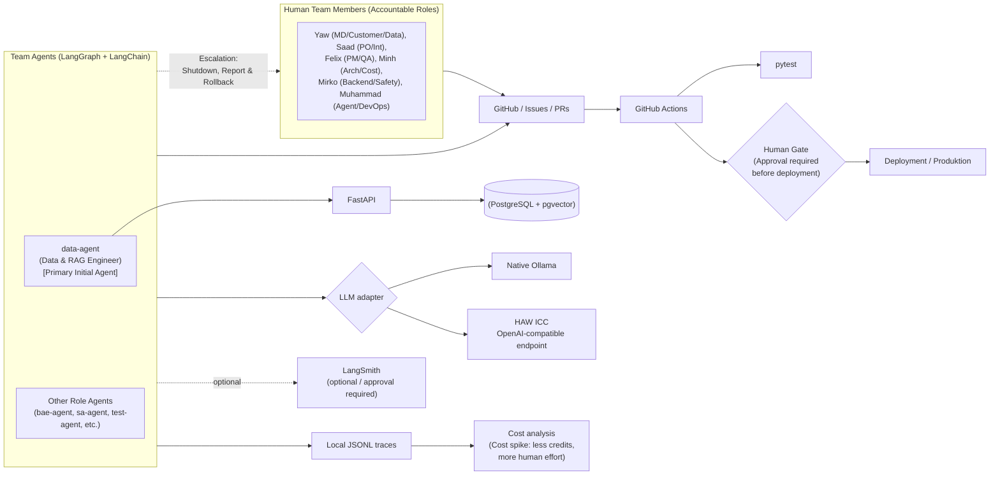

# Architecture – initial course baseline

> Team-owned after Session 1. Adapt this document so that it reflects the real company infrastructure.

## Baseline design decisions

1. Agent orchestration uses LangGraph.
2. LangChain provides model/integration abstractions.
3. Team code must not depend directly on a specific LLM deployment.
4. PostgreSQL + pgvector is the common relational and vector data platform.
5. Local structured traces are mandatory project evidence.
6. LangSmith is optional and cannot replace local evidence.
7. Ollama normally runs natively on the host when used on macOS.

## Team changes
Hier ist ein passender Entwurf für den Abschnitt **„Team changes“** in eurer `docs/architecture.md`, der alle wesentlichen Anpassungen (wie den `data-agent`, die Rollenverteilung, das Human Approval Gate und die Eskalations-/Kostenregeln) dokumentiert und auf entsprechende ADRs (Architecture Decision Records) verweist:

---

## Team changes

Wir haben die initiale Baseline-Architektur an die organisatorischen und technischen Anforderungen der **mimumisaseya gmbh** angepasst. Die wesentlichen Änderungen im Überblick:

1. **Einführung des ersten Team-Agenten (`data-agent`):**
* Gemäß unseren Pflichtentscheidungen wird das **Data Engineering** als erster Bereich aktiv durch einen Agenten (`data-agent` für den `data_rag_engineer`) unterstützt.

* Der Agent ist direkt an die FastAPI-Schnittstelle sowie die PostgreSQL-Datenbank mit `pgvector` angebunden, um Vektoreinbettungen, Ingestion und Retrieval automatisiert zu steuern.

2. **Human Approval Gate vor dem Deployment:**
* Entsprechend unseren Working Rules ist eine verbindliche menschliche Zustimmung (Human Approval Gate) strikt vor jedem Produktions-Deployment in der CI/CD-Pipeline (`GitHub Actions`) integriert.

3. **Eskalations- und Rollback-Mechanismus:**
* Kritische Agenten-Aktionen und unerwartete Fehler lösen einen definierten Eskalationspfad aus: **Agent abschalten, Report generieren und automatischer Rollback**.

4. **Kosten- und Trace-Management:**
* Alle Agenten-Interaktionen werden über lokale JSONL-Traces und anschließende Kostenanalysen überwacht. Bei einem unerwarteten Kostenanstieg wird gemäß unseren Regeln gegengesteuert (**weniger Credits, mehr menschlicher Aufwand**).

5. **Rollenbasierte Verantwortlichkeiten:**
* Die Teamrollen wurden gemäß `roles.yaml` aufgeteilt. Operative Rollen (wie der Product Owner) bleiben bewusst menschlich, während technische Rollen (wie Backend, DevOps und Software Architecture) hybrid oder agentisch unterstützt werden.

> **AdRs (Architecture Decision Records):**
> * [ADR-001: Einführung des Data & RAG Agents als erste Automatisierungsstufe](https://www.google.com/search?q=./adrs/001-data-agent.md) *(geplant/erstellt)*
> * [ADR-002: Verbindliches Human Approval Gate vor CI/CD-Deployments](https://www.google.com/search?q=./adrs/002-human-gate-deployment.md) *(geplant/erstellt)*
> 
>
