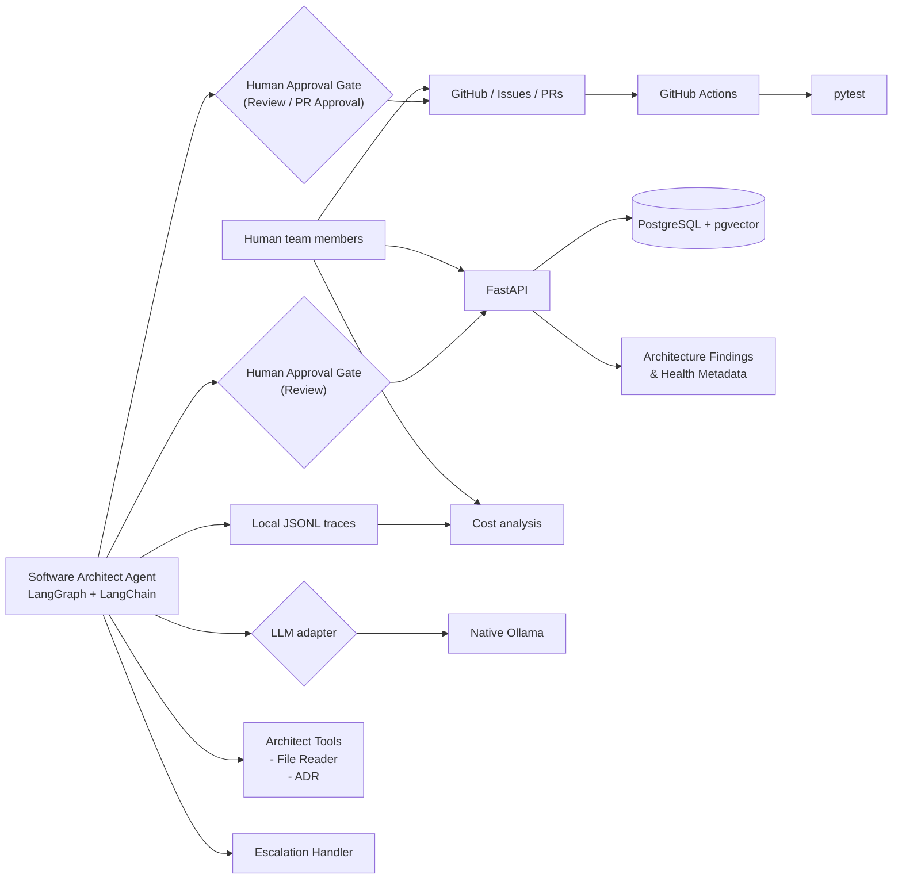

# Architecture – initial course baseline

> Team-owned after Session 1. Adapt this document so that it reflects the real company infrastructure.

## Baseline design decisions

1. Agent orchestration uses LangGraph.
2. LangChain provides model/integration abstractions.
3. Team code must not depend directly on a specific LLM deployment.
4. PostgreSQL + pgvector is the common relational and vector data platform.
5. Local structured traces are mandatory project evidence.
6. LangSmith is optional and cannot replace local evidence.
7. Ollama normally runs natively on the host when used on macOS.

## Team changes

Document all material changes here and add ADRs where appropriate.

### Session 1:
For the first session, we decided to make an agent for the role Software Architect. We also changed the architecture, company and role documents.
#### ADR 1
We needed to choose one role to make the first agent for. The Software Architect is a role that is mainly analysis focused, hence our decision to automate it first. This allows us to understand how to create agents by starting with an easier to code agent. 